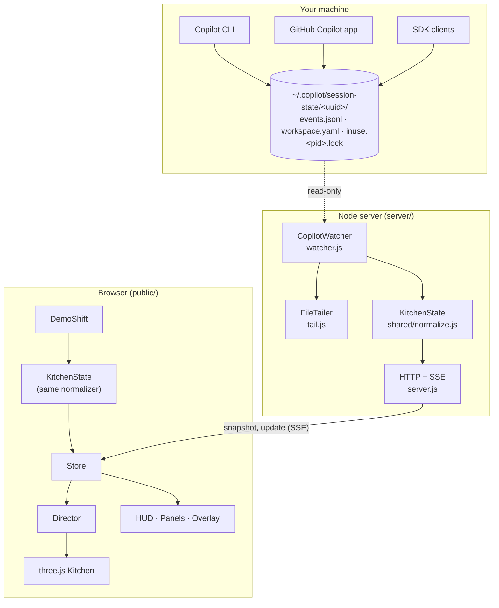

# Architecture

Agent Kitchen has two halves that share one brain:



- **`public/shared/`** holds the code both halves run: the station catalog/classifier (`stations.js`) and the event normalizer (`normalize.js`). It's plain ESM with no Node or DOM APIs.
- In **live mode** the server normalizes events and the browser only renders.
- In **demo mode** the browser generates synthetic Copilot events and runs them through the very same normalizer, so the demo exercises the real pipeline (and works from a static file server).

## 1. Reading Copilot activity

The Copilot CLI, the GitHub Copilot app (which runs the CLI under the hood) and SDK clients all keep per-session state in `~/.copilot/session-state/<session-uuid>/` (or `$COPILOT_HOME/session-state`):

| File | Used for |
|---|---|
| `events.jsonl` | Append-only event log; one JSON object per line |
| `workspace.yaml` | Session name, summary, repository, branch, cwd, client (`github/autopilot` = app, `github/cli` = CLI) |
| `inuse.<pid>.lock` | Written when a Copilot process opens the session; removed on a clean exit, left behind after a crash |

`CopilotWatcher` (`server/watcher.js`):

1. **Scans** the folder every 3 s. A session is loaded if its `events.jsonl` changed since `--since` (default: midnight) or its lock file names a live process. Older sessions are remembered by mtime and loaded the moment they change (e.g. a resumed session).
2. **Replays** a newly tracked file (up to the last 64 MB) silently to rebuild state — tickets, stats, current tool — without animating history.
3. **Polls** tracked files every 500 ms. `FileTailer` reads only the new bytes, keeps partial trailing lines (and split UTF-8 characters) for the next read, and restarts if a file shrinks.
4. **Checks liveness** (`server/liveness.js`): a chef is on shift while its session has a *live* lock, or for a 5-minute grace period after its last event. A lock is live only if a process with that PID exists **and** started before the lock was written. A crashed process leaves its lock behind and the OS eventually hands the PID to some unrelated program, which `process.kill(pid, 0)` alone can't tell apart. Start times come from one batched lookup per new lock (PowerShell `Get-Process` on Windows, `/proc` on Linux, `ps` on macOS) and are cached; if they can't be looked up, the watcher falls back to trusting the PID. When the process is gone, in-flight tools and open tickets are cleared and the chef clocks out.

Events are filtered before parsing: Copilot writes `{"type":"…` first, so `wantsLine()` skips the large lines the kitchen doesn't need (model snapshots, hooks, usage records) without `JSON.parse`. A typical startup (8 sessions, tens of MB) takes ~0.4 s.

The watcher never writes anything to the state folder.

## 2. The event model

`SessionTracker.ingest(event)` (`public/shared/normalize.js`) is a small state machine per session. It keeps:

- `orders` — open tickets (one per `user.message`/`interactionId`)
- `tools` — in-flight tool calls by `toolCallId`
- `subagents` — active sub-agents by `agentId`
- `stats` — served, cancelled, coins, steps, fires, steps per station (only events after `countFrom` count)
- `recent` — the last 30 steps with ✓/✗, for the Brigade panel

and returns **effects** (`fx`) for the renderer:

| Raw event | State change | Effect |
|---|---|---|
| `session.start` / `session.resume` | metadata (repo, branch, model) | — |
| `user.message` | open an order (steering messages reuse the running interaction's id and join its ticket) | `order` |
| `assistant.turn_start` | in a turn; remembers the active `interactionId` and opens an implicit "Follow-up" order if it has none | `order` (implicit) |
| `assistant.message` | remember whether it requested tools | `say` (first sentence) |
| `assistant.turn_end` | if the last message had no tool requests → the active interaction finished | `served` (coins) |
| `tool.execution_start` | add tool; classify station; add station to the order's ingredients | `tool` |
| `tool.execution_complete` | remove tool; failure = `success:false` **or** non-zero `shellExecution.exitCode` / `completed with exit code N` | `tool-end`, `fire` |
| `subagent.started` / `completed` / `failed` | sous-chef joins / leaves | `sub-start`, `sub-end` |
| `abort` | cancel the active order (−10 coins) | `failed` |
| `session.error` | fire at the chef's current station | `fire` |
| `permission.requested` / `completed` | chef waits at the order bell | — |
| `session.compaction_start` / `complete` | chef "tidies up" at the sink | `say` |
| `session.task_complete` | serve the active order (autopilot) | `served` |
| `session.shutdown` | chef clocks out | — |

Events from sub-agents carry a top-level `agentId`; their tools are tracked separately so they move the sous-chef, not the head chef, and don't add ingredients to the head chef's ticket.

**Tickets follow interactions.** Steps are credited to the active interaction's ticket, and serving or cancelling closes only that ticket, so a prompt queued behind a running interaction keeps its own. Older tickets that never got an ending of their own are cleared without coins. Sessions without interaction ids (older Copilot versions) fall back to closing every open ticket.

**Status** is derived, not stored: `offline` (process gone / shut down) → `waiting` (ask_user or a permission prompt) → `working` (a tool is running, a sub-agent is active, or compacting) → `thinking` (in a turn, between tools) → `idle`.

**Coins**: 20 per served order plus a speed tip (+8 under a minute, +6 under 3, +4 under 10, +2 under 30). Cancelled orders cost 10; the total never goes below zero.

## 3. Classifying work into stations

`classifyTool(name, args)` (`public/shared/stations.js`) returns `{ station, label }`:

1. **Known tools** map directly (`view` → read, `edit` → code, `web_fetch` → research, `ask_user` → ask, `task_complete` → ship, …).
2. **`apply_patch`** is parsed for `*** Add/Update/Delete File:` lines; delete-only patches go to the bin.
3. **MCP tools** (`server-tool_name`) default to research; names like `create_pull_request`, `push_files`, `send_*` ship, `delete_*` bins, `search_code` searches.
4. **Shell commands** (`powershell`, `bash`, …) are split into segments on `&&`, `||`, `;`, `|` and newlines. Each segment is tokenized, prefixes like `sudo`, `npx -y`, `cmd /c`, `$x =` and env assignments are stripped, and the command is matched by tool family: `git` sub-commands, `gh` areas, `npm/pnpm/yarn/bun` scripts (`test:*`, `build`, `lint`…), `python -m`, `cargo`, `go`, `dotnet`, `make`/`gradle`/`mvn` targets, `docker`, `kubectl`, `terraform`, linters, test runners, and generic file/search/network commands. The highest-priority segment wins (`ship > commit > test > build > lint > install > trash > research > search > read > shell`). If nothing matched, the tool's human `description` is used as a hint ("Run unit tests" → test).
5. **Follow-ups** (`read_powershell`, `write_powershell`, …) inherit the station of the shell they refer to, so waiting on a long build keeps the chef at the rice cooker.

To add a station: add it to `STATIONS`, map tools/commands to it, place a letter for it in `MAP` (`public/js/scene/layout.js`), and write a builder in `stationProps*.js`. `test/layout.test.js` checks that every catalog station exists in the kitchen and is reachable.

## 4. The kitchen and its chefs

### Scene (`public/js/scene/`)

- `world.js` — renderer, ACES tone mapping, soft shadows, and a fixed 56° "diorama" camera that binary-searches its distance so the kitchen always fits the window (leaving room for the HUD).
- `layout.js` — the floor plan as an ASCII map, tile ↔ world conversion, station access tiles (where a chef stands, facing which way), spare "overflow" spots, idle spots, and A* pathfinding with line-of-sight smoothing.
- `kitchen.js`, `environment.js`, `stationProps*.js`, `build.js` — everything is built from primitives (rounded boxes, cylinders, spheres) with procedural canvas textures: plank floors, shoji walls, crate lids with painted ingredients, conveyor belts. Counters are instanced. Each station has an `animate()` that reacts to `activity` (0–1, eased) — lids open, knives chop, pots rattle and steam, baskets dip into bubbling oil, water runs, plates assemble.
- `chef.js` — the chef model (body, head, toque or bandana, floating hands, feet, blob shadow) and a pose function for walking and for each station action (chop, stir, fry, wash, grab, read, plate, serve, bin, wait, extinguish), plus moods (happy, sad, panic, sleep).
- `fx.js` — two GPU point-sprite layers (soft + additive glow) for steam, smoke, fire, embers, bubbles, water, foam, dust, sparkles and poofs.

### Director (`public/js/director.js`)

The director turns session state + effects into chef behaviour:

- Each `tool` effect becomes a **task** in the chef's queue (consecutive tools at the same station merge). Each task has a minimum dwell time so quick steps (a 50 ms file read) stay visible, but the queue is capped at 3 and older *finished* steps are dropped first, so chefs never fall far behind real time. Chefs dash when they have a backlog.
- Starting a task reserves a free **spot** at the nearest matching station (or an overflow spot beside it), so chefs don't stand inside each other. Burning stations are avoided.
- When nothing is queued, the chef follows the **ambient** state: the station of the tool that's still running, the order bell when waiting on you, the recipe book after ~3 s of thinking, or an idle spot (falling asleep after 25 s).
- **Special tasks**: a `fire` effect makes the chef panic, grab the extinguisher and spray foam at the station; a `served` effect turns the pending ship step into a hand-off at the serving hatch (dish slides down the conveyor, sparkles, +coins).
- Sous-chefs spawn at the door for `subagent.started`, run their own queue from tools tagged with their `agentId`, and walk out after `subagent.completed`.

### HUD (`public/js/hud.js`, `panels.js`, `overlay.js`)

HTML on top of the canvas: order tickets, coin counter, clock, ticker, Brigade, Menu, Settings, and 3D-pinned labels (station names, cooking progress bars, fire alerts, chef name tags, speech bubbles, emotes, coin pop-ups). All untrusted text (prompts, file names, session names) is escaped before it reaches `innerHTML`. **Privacy mode** swaps prompts, session names, branch/folder names, file names and chatter for generic labels.

## 5. Server API

| Route | |
|---|---|
| `GET /` | the app (`public/`) |
| `GET /api/state` | JSON snapshot: visible sessions + totals |
| `GET /api/stream` | Server-Sent Events: `snapshot` on connect, then `update` `{ sessions, removed, fx, totals }` as things change, plus a keep-alive comment every 15 s |
| `GET /api/health` | readiness and counts |

Security: binds `127.0.0.1`; rejects non-local `Host` headers (DNS rebinding); `GET`/`HEAD` only; static files are confined to `public/` (path traversal is rejected); strict CSP, `nosniff`, `X-Frame-Options: DENY`, `Referrer-Policy: no-referrer`.

## 6. Testing

```sh
npm test
```

- `test/stations.test.js` — the tool and shell classifier (100+ real-world commands).
- `test/normalize.test.js` — the session state machine: full orders, fires, background shells, sub-agents, waiting, aborts, liveness, stats windows.
- `test/server-units.test.js` — tailer (partial lines, split UTF-8, truncation), YAML, CLI options, host checks, path traversal, browser launch.
- `test/liveness.test.js` — lock liveness: recycled PIDs, caching, fallback, and start-time parsing for Windows, Linux and macOS (plus a real lookup on the current OS).
- `test/integration.test.js` — a real watcher + HTTP server against a temp state folder: discovery, tailing, renames, clock-out, crashed sessions with recycled PIDs, SSE snapshot/update.
- `test/layout.test.js` — every station is in the kitchen and reachable; idle spots don't block stations.

Visual checks use `scripts/shot.js` (headless Edge/Chrome over the DevTools protocol, zero dependencies), which fails on any page error; `npm run screenshots` drives a full demo shift and captures the docs images.
